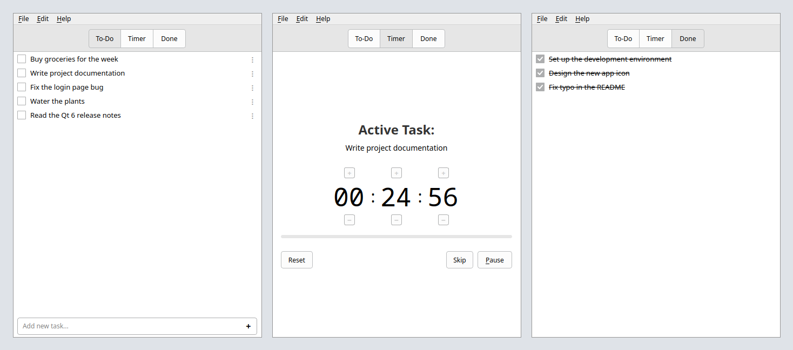

# QGoForIt

**QGoForIt** is a lightweight to-do list application written in C++ / Qt 6 inspired by GoForIt GTK application, but it is not a full clone. Not all features that were in GoForIt were implemented.

Tasks are stored in plain text files (`todo.txt` / `done.txt`), so your data
stays portable and editable with any text editor.

---

## Screenshot



---

## Features

* Two lists: active tasks (To-Do) and completed tasks (Done)
* Plain-text storage following the todo.txt idea (`x ` marks completed tasks)
* Double-click to rename a task inline
* Drag and drop to reorder tasks
* Completing a task moves it to the Done list with a completion date
* Unchecking a task in Done returns it to the To-Do list
* Built-in task timer (select a task, then open the Timer page):
  * Configurable work and break durations (Settings → Timer)
  * Start / Pause / Resume / Skip / Reset controls
  * Work period auto-followed by a break; optional auto-resume after the break
  * Desktop notifications on phase completion via the D-Bus
    org.freedesktop.Notifications service
* Remembers window geometry between sessions

## New features that were not in GoForIt

* Automatic cleanup of completed tasks older than N days (optional)
* Optional watching of todo.txt for external changes (edit it in any editor)
* Single-instance lock
* Portable mode: data, config, icons and translations are stored next to the executable

---

## Wayland

On Wayland, window positioning is limited by the compositor.
For full functionality (window placement), run the app using XWayland:

QT_QPA_PLATFORM=xcb QGoForIt

---

## Qt6 and Taskbar

If you want the notes to not appear in the taskbar, you can use KWin Window Rules and disable taskbar entries for QGoForIt windows.

---

## Requirements

* Qt 5.15+ or Qt 6.4+
* CMake 3.16+
* C++20 compatible compiler

---

## Build

```bash
git clone https://github.com/ivnish/QGoForIt.git
cd QGoForIt

mkdir -p build/Release
cd build/Release

cmake -DCMAKE_INSTALL_PREFIX=/usr -DCMAKE_BUILD_TYPE=Release ../..
make -j$(nproc)
```

---

## Install

```bash
sudo make install
```

By default, this installs:

* Binary → `/usr/bin/QGoForIt`
* Icons → `/usr/share/QGoForIt/icons`
* Translations → `/usr/share/QGoForIt/translations`
* Desktop entry → `/usr/share/applications/QGoForIt.desktop`

---

## Uninstall

```bash
sudo make uninstall
```

---

## Building a .deb Package

QGoForIt can be packaged as a Debian package using CPack (included with CMake).

### Build the package

```bash
mkdir -p build/Release
cd build/Release

cmake -DCMAKE_INSTALL_PREFIX=/usr -DCMAKE_BUILD_TYPE=Release ../..
make -j$(nproc)

cpack
```

### Result

After running `cpack`, a `.deb` file will be generated in the build directory, for example:

```
QGoForIt_0.1_amd64_qt6_24.04_26.04.deb
```

### Install

```bash
sudo apt install ./QGoForIt_0.1_amd64_qt6_24.04_26.04.deb
```

If there are missing dependencies:

```bash
sudo apt-get install -f
```

---

## Data Location

* Tasks → `~/.local/share/QGoForIt/todo.txt` and `done.txt`
* Configuration → `~/.config/QGoForIt/config.ini`

---

## Translations

QGoForIt supports translations using Qt's translation system.

* Translation files are located in the `translations/` directory
* Language is detected automatically based on system locale

---

## Portable Mode

To run QGoForIt in portable mode, create an empty file named `portable` next
to the executable. In this mode everything is kept in the application folder:

* Tasks → `<app folder>/todo.txt` and `done.txt`
* Configuration → `<app folder>/config.ini`
* Icons → `<app folder>/icons`
* Translations → `<app folder>/translations`

Without the marker file the standard system locations are used (see Data Location).

---

## License

GPLv3 License
